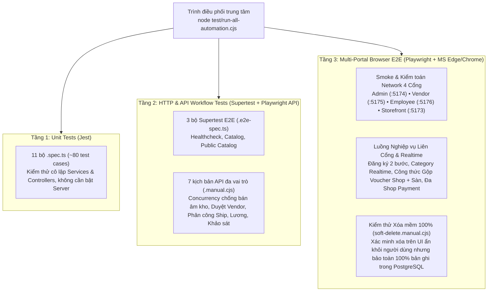

# Hướng Dẫn Chạy & Phát Triển Automation Test — Hệ Thống TMĐT MIVA

Tài liệu này hướng dẫn chi tiết cách vận hành, trình chiếu trực quan (Visual Demo), quay video báo cáo và mở rộng hệ thống **Kiểm thử Tự động 3 Tầng (3-Tier Automation Testing)** cho toàn bộ 4 cổng giao diện và Backend của dự án **MIVA E-Commerce**.

---

## 1. Kiến trúc Hệ thống Automation Test 3 Tầng

Hệ thống kiểm thử tự động được đặt tại `htttdn/backend/test/` và `htttdn/backend/src/**/*.spec.ts`, bao phủ từ logic đơn vị đến luồng trình duyệt đa vai trò theo thời gian thực (Socket.IO Realtime) và kiểm toán trực tiếp trong cơ sở dữ liệu PostgreSQL:



### Nguyên tắc An toàn Dữ liệu khi Chạy Test
- **Tự tạo & Tự dọn dữ liệu tạm (`Disposable Fixtures`)**: Mọi kịch bản đều sinh dữ liệu có tiền tố định danh riêng (`TEST-*`, `MULTI-PAY-*`, `CONCURRENT-*`, ...) và tự động dọn sạch trong khối `finally` ngay cả khi test gặp lỗi. **Tuyệt đối không làm hỏng dữ liệu mẫu hiện có của đồ án.**
- **Tự động Khởi chạy Dịch vụ (`Smart Auto-Boot`)**: Khi chạy qua `run-all-automation.cjs`, nếu bạn đã bật sẵn Backend và 4 cổng Vite ở các cửa sổ Terminal khác, trình chạy sẽ kết nối dùng ngay (`0 giây` chờ). Nếu cổng nào chưa bật, trình chạy sẽ **tự động khởi động ngầm** dịch vụ đó, đợi cổng sẵn sàng, chạy test xong và tự tắt gọn tiến trình con.

---

## 2. Yêu cầu Môi trường, Bảng Cổng & Tài khoản Test Mặc định

### 2.1. Bảng Cổng Dịch vụ (Ports)

| Dịch vụ | Thư mục nguồn | Cổng mặc định | Vai trò trong Automation Test |
| :--- | :--- | :---: | :--- |
| **PostgreSQL** | Docker / Local Service | `:5433` | CSDL chính (`ecommerce`), bắt buộc đang chạy cho Tầng 2 & Tầng 3 |
| **Backend API & Socket.IO** | `htttdn/backend` | `:3000` | Cung cấp REST API `/api/*` và kênh đồng bộ `/realtime` |
| **Customer Storefront** | `htttdn/frontend` | `:5173` | Cổng mua sắm Khách hàng |
| **Admin Portal** | `htttdn/admin` | `:5174` | Cổng Quản trị Sàn (7 Workspace hợp nhất) |
| **Vendor Portal** | `htttdn/vendor` | `:5175` | Cổng Người bán / Kênh Đối tác |
| **Employee Portal** | `htttdn/employee` | `:5176` | Cổng Nhân viên Vận hành & Giao vận |

### 2.2. Tài khoản Seed Mặc định Dùng cho Kịch bản Tự động

Các kịch bản tự động đọc từ biến môi trường (nếu có) hoặc tự động dùng tài khoản seed chuẩn dưới đây:

| Vai trò | Biến môi trường ghi đè | Email mặc định | Mật khẩu mặc định |
| :--- | :--- | :--- | :--- |
| **Admin Sàn** | `MIVA_TEST_ADMIN_EMAIL` / `MIVA_TEST_ADMIN_PASSWORD` | `admin1@miva.vn` | `admin123` |
| **Vendor (Shop)** | `MIVA_TEST_VENDOR_EMAIL` / `MIVA_TEST_VENDOR_PASSWORD` | `vendor1@miva.vn` | `admin123` |
| **Nhân viên** | `MIVA_TEST_EMPLOYEE_EMAIL` / `MIVA_TEST_EMPLOYEE_PASSWORD` | `employee1@miva.vn` | `admin123` |
| **Khách hàng** | *(Tự tạo tài khoản tạm riêng cho mỗi lần chạy)* | `test-*@example.com` | *(Tự sinh & tự xóa)* |

> **Lưu ý cài đặt lần đầu**: Đảm bảo đã chạy `npm install` ở các thư mục `backend`, `frontend`, `admin`, `vendor`, `employee` và CSDL PostgreSQL (`:5433`) đã có dữ liệu seed (`npx prisma db push` & seed dữ liệu mẫu). Trình duyệt Microsoft Edge (`msedge` có sẵn trên Windows) được dùng mặc định nên không cần tải thêm Chromium rời.

---

## 3. Bảng Lệnh Chạy Nhanh (`1-Click Commands`)

Mở Terminal và di chuyển vào thư mục `backend`:

```powershell
cd C:\DoAnHTTDN\htttdn\backend
```

Sau đó sử dụng một trong các lệnh chuẩn sau:

| Lệnh chạy | Mục đích sử dụng | Chế độ hiển thị |
| :--- | :--- | :--- |
| `npm run test:auto:quick` | Chạy nhanh **Unit Tests + Supertest HTTP E2E** (kiểm tra logic cốt lõi sau khi sửa code) | Chạy ngầm (Terminal) |
| `npm run test:auto:api` | Chạy toàn bộ **7 kịch bản API đa vai trò & Concurrency** | Chạy ngầm (Terminal) |
| `npm run test:soft-delete` | Chạy kịch bản kiểm chứng **Xóa mềm 100% (UI + API + PostgreSQL)** | Headless nhanh |
| `npm run test:auto:ui` | Chạy toàn bộ **10 kịch bản trình duyệt Playwright trên cả 4 cổng** | Headless nhanh |
| `npm run test:auto` | **Chạy trọn bộ cả 3 tầng (`19` bộ test từ A–Z)** và xuất báo cáo tổng hợp | Headless nhanh |
| `npm run test:auto:demo` | **Chế độ Bảo vệ Đồ án**: Mở cửa sổ trình duyệt thật + làm chậm thao tác + quay video `.webm` | **Trực quan + Quay Video** |

Sau mỗi lần chạy qua trình điều phối, bảng tổng kết chi tiết sẽ hiển thị ngay trên màn hình console đồng thời lưu thành file Markdown tại:
`htttdn/backend/test/LATEST_AUTOMATION_REPORT.md`

---

## 4. Hướng dẫn Chạy Trình Chiếu Trực Quan (Visual Demo) & Quay Video `.webm`

Khi thuyết trình nhóm hoặc **bảo vệ đồ án trước Hội đồng**, bạn có thể mở trực tiếp cửa sổ trình duyệt để giảng viên quan sát con trỏ tự động đăng nhập, tạo danh mục, áp mã giảm giá gộp, thanh toán tách đơn và xóa mềm sản phẩm theo thời gian thực.

### 4.1. Chạy Demo một kịch bản cụ thể (Khuyên dùng khi thuyết trình)

Tại thư mục `C:\DoAnHTTDN\htttdn\backend`:

```powershell
# 1. Demo trực quan Công thức tính tiền gộp Voucher Shop + Voucher Sàn (từ Thẻ SP -> Giỏ hàng -> Checkout)
node test/run-all-automation.cjs --filter=voucher-pricing --demo

# 2. Demo trực quan Xóa mềm 100% (Xóa trên UI Vendor/Admin nhưng kiểm tra DB vẫn còn nguyên)
node test/run-all-automation.cjs --tier=soft-delete --demo

# 3. Demo trực quan Đồng bộ Đơn hàng & Doanh thu Realtime giữa 3 cổng (Khách đặt -> Admin duyệt -> Shop đóng gói -> Giao thành công)
node test/run-all-automation.cjs --filter=vendor-sync --demo

# 4. Demo trực quan Thanh toán tách đơn 2 Shop (1 đơn lỗi thẻ -> đơn kia vẫn thanh toán -> thanh toán lại thành công)
node test/run-all-automation.cjs --filter=multi-vendor-payment --demo

# 5. Demo trực quan Đăng ký Đối tác Bán hàng 2 bước & Chặn đăng nhập trước khi Admin duyệt
node test/run-all-automation.cjs --filter=registration-login --demo

# 6. Chạy nối tiếp nhiều kịch bản tiêu biểu cùng lúc (phân tách bằng dấu phẩy)
node test/run-all-automation.cjs --filter=soft-delete,voucher-pricing,vendor-sync --demo
```

### 4.2. Tùy chỉnh Tốc độ Thao tác (`Slow-Mo`) & Trình duyệt

Bạn có thể điều chỉnh tốc độ từng cú click/gõ phím (tính bằng mili-giây) để dễ thuyết minh:

```powershell
# Chậm rãi rõ ràng (600ms mỗi thao tác), chỉ mở trình duyệt mà không cần ghi file video:
node test/run-all-automation.cjs --filter=category-realtime --headed --slow-mo=600

# Vừa mở trình duyệt tốc độ 300ms vừa ghi hình lại thành file .webm:
node test/run-all-automation.cjs --filter=soft-delete --headed --slow-mo=300 --video
```

**Nơi lưu Video tự động**: Toàn bộ file video `.webm` chất lượng cao được lưu tự động theo từng thư mục kịch bản tại:
`C:\DoAnHTTDN\htttdn\test-recordings\<ten-kich-ban>\`

Bạn có thể mở trực tiếp các file `.webm` này bằng Microsoft Edge, Chrome hoặc VLC để chèn vào slide PowerPoint báo cáo.

---

## 5. Danh mục Chi tiết 19 Bộ Kịch bản Kiểm thử trong Dự án

### Tầng 1 — Jest Unit Tests (`--tier=unit`)
1. **`jest-unit` (`src/**/*.spec.ts` — 11 suites / 80 tests)**:
   - Kiểm thử cô lập logic nghiệp vụ `ProductsService` (ẩn sản phẩm xóa mềm, giải phóng slug), `OrdersService` & `OrdersFulfillment` (tách kiện theo shop, hoàn kho & mở lại lượt dùng voucher khi hủy đơn), `VouchersService` (công thức giảm giá tuần tự Shop -> Sàn), `SurveysService`, `ReportsService`, `AuthService`, `RealtimeGateway`, `ProductVariantService`, `CategoryController`.

### Tầng 2 — HTTP E2E & API Workflows (`--tier=http` & `--tier=api`)
2. **`jest-http-e2e` (`test/*.e2e-spec.ts`)**: Kiểm thử tích hợp HTTP qua Supertest cho `/api/health`, `/api/categories` và `/api/products` công khai.
3. **`api-detail` (`test/api-detail.manual.cjs`)**: Kiểm thử toàn bộ API chi tiết và thao tác CRUD của Khách hàng (Sổ địa chỉ, Yêu thích sản phẩm, Thêm/Sửa/Xóa giỏ hàng, Hồ sơ cá nhân, Đọc thông báo).
4. **`api-workflows` (`test/api-workflows.manual.cjs`)**: Kiểm thử vòng đời Quản trị Nhân sự -> Nhân viên chấm công -> Admin tính bảng lương tháng -> Xem phiếu lương -> Tạo/Sửa/Xóa khảo sát qua API.
5. **`checkout-concurrency` (`test/checkout-concurrency.manual.cjs`)**: **Kiểm thử chống Race Condition**: Giả lập 2 khách hàng bấm thanh toán cùng một mili-giây cho sản phẩm chỉ còn `stock = 1` (đảm bảo đúng 1 người mua được, người còn lại nhận `400/409`, tồn kho về `0` không bao giờ âm) và chống nhân đôi đơn khi bấm đúp nút Đặt hàng.
6. **`order-assignment` (`test/order-assignment.manual.cjs`)**: Kiểm thử ràng buộc phân công nhân viên giao hàng (chặn gán nhân viên đang `inactive`, chặn gán lại đơn đã đóng, kiểm tra gán trực tiếp & tự động chia tải).
7. **`product-upload` (`test/product-upload.manual.cjs`)**: Kiểm thử upload ảnh PNG thật qua multipart API của Vendor, tải lại file tĩnh và chặn tệp giả mạo sai định dạng MIME (`.txt`).
8. **`vendor-approval` (`test/vendor-approval.manual.cjs`)**: Kiểm thử phân quyền RBAC giữa các phòng ban Nhân viên khi duyệt hồ sơ Vendor, chống duyệt lặp (`409`), gia hạn gói hợp tác 1 năm / 2 năm và khóa đăng nhập khi bị từ chối.
9. **`survey-inbox` (`test/survey-inbox.manual.cjs`)**: Kiểm thử tự động phát phiếu khảo sát sau khi đặt hàng (`after_checkout`) và cô lập quyền riêng tư (khách hàng khác không thể xem, mở, bỏ qua hoặc gửi câu trả lời hộ).

### Tầng 3 — Multi-Portal Playwright Browser E2E (`--tier=browser`)
10. **`soft-delete` (`test/soft-delete.manual.cjs`)**: Kiểm thử toàn diện **Xóa mềm 100%** trên UI + API + PostgreSQL cho `Product`, `ProductColor`, `ProductVariant`, `Voucher` (Admin & Vendor), `VoucherDetail` (`reversedAt`), `Survey`, `SurveyQuestion`, `SurveyOption`, `CartItem` và `ProductFavorite` (kèm kiểm chứng khôi phục bản ghi khi thêm lại vào giỏ / thả tim lại và giải phóng `slug` khi tạo lại sản phẩm trùng tên).
11. **`portal-smoke` (`test/portal-smoke.manual.cjs`)**: Đăng nhập tự động và đi qua hơn **35 trang giao diện** trên cả 4 cổng (`Admin`, `Vendor`, `Employee`, `Client`), đảm bảo 100% trang HTTP `200`, không trắng trang, không văng lỗi JavaScript (`pageerror`), không lỗi API `5xx`.
12. **`api-calls` (`test/api-calls.manual.cjs`)**: Mở từng trang trên 4 cổng và ghi nhận toàn bộ lưu lượng mạng `/api/*`, đảm bảo không có bất kỳ request ngầm nào trả về mã lỗi `>= 400`.
13. **`registration-login` (`test/registration-login.manual.cjs`)**: Kiểm thử điền form Đăng ký Khách hàng và **Wizard Đăng ký Đối tác Bán hàng 2 bước**, kiểm tra trạng thái chờ duyệt (`403` trước khi Admin duyệt) và cấp phiên cookie riêng biệt từng cổng sau khi duyệt.
14. **`category-realtime` (`test/category-realtime.manual.cjs`)**: Mở song song trình duyệt Admin và Khách hàng -> Admin thêm/khóa/mở khóa/đổi tên/xóa mềm danh mục -> Trang chủ Khách hàng tự động cập nhật ngay lập tức qua Socket.IO mà **không reload trang (`navigations === 0`)**.
15. **`admin-voucher` (`test/admin-voucher.manual.cjs`)**: Kiểm thử UI Quản lý Mã giảm giá Toàn sàn của Admin (tạo mã `%`, mã số tiền cố định, chuẩn hóa múi giờ ngày bắt đầu/kết thúc, sửa không rò rỉ trường hệ thống, chặn trùng mã & dữ liệu âm/quá 100%).
16. **`vendor-voucher` (`test/vendor-voucher.manual.cjs`)**: Kiểm thử UI Tạo Mã giảm giá Gian hàng (chỉ hiển thị sản phẩm thuộc quyền sở hữu của Shop, tính thử giá giảm trực tiếp trong Modal, tự động phát hiện nếu sản phẩm bị xóa mềm trong lúc đang mở form).
17. **`voucher-pricing` (`test/voucher-pricing.manual.cjs`)**: Kiểm thử xuyên suốt công thức tính tiền khi áp dụng đồng thời **Voucher Shop (20%) + Voucher Sàn (10%)**: Giá gốc `200.000 ₫` -> sau mã Shop còn `160.000 ₫` -> sau mã Sàn còn `144.000 ₫` đồng nhất từ Thẻ sản phẩm -> Chi tiết SP -> Giỏ hàng -> Checkout -> Bản ghi `Order`, `VendorOrder` và `Payment` trong DB; kèm kiểm tra tự khóa nút Đặt hàng realtime nếu Shop bất ngờ tắt voucher.
18. **`multi-vendor-payment` (`test/multi-vendor-payment.manual.cjs`)**: Kiểm thử đặt giỏ hàng gồm 2 Shop khác nhau bằng Thẻ tín dụng Demo -> tách thành hàng đợi 2 phiên thanh toán nối tiếp -> giả lập đơn 1 thanh toán thất bại vẫn chuyển sang thanh toán đơn 2 -> quay lại thanh toán lại đơn 1 thành công.
19. **`vendor-sync` (`test/vendor-sync.manual.cjs`)**: Mở đồng thời 4 cửa sổ trình duyệt (`Admin`, `Vendor`, `Khách hàng`, `Khách vãng lai`) -> Kiểm chứng vòng đời trọn vẹn từ tạo sản phẩm, đổi giá/tồn kho realtime, đặt hàng COD, Admin xác nhận, Vendor đóng gói -> bàn giao bưu tá -> giao thành công -> tự động cộng **Doanh thu thuần** trên Dashboard Vendor mà không reload bất kỳ trang nào.
20. **`thesis-showcase` (`test/thesis-showcase.manual.cjs`) — CHẾ ĐỘ BẢO VỆ ĐỒ ÁN (8 Chương Liên Hoàn)**: Trình diễn trực quan 100% trên giao diện thật qua đủ **4 Cổng & 5 Vai trò** kèm thanh phụ đề **MIVA Thesis HUD**, vòng sáng Spotlight thao tác, xuất bộ ảnh minh chứng 8 Chương + 5 video `.webm` chuẩn HD (`1440×900`).

---

## 5B. Kịch Bản Thuyết Trình Bảo Vệ Đồ Án (8 Chương — Kèm Lời Thuyết Minh Gợi Ý)

Khi đứng trước Hội đồng chấm đồ án, chỉ cần mở Terminal tại `C:\DoAnHTTDN\htttdn\backend` và gõ:

```powershell
# Chế độ chuẩn khuyên dùng trên máy chiếu (slowMo=800ms + dừng chuyển bước 1400ms + HUD + Quay video .webm)
npm run test:doan

# Chế độ siêu chậm (slowMo=1200ms) nếu muốn vừa chạy vừa giảng giải sâu từng ô nhập liệu
npm run test:doan:slow

# Chế độ kiểm tra nhanh Headless trước giờ lên bục bảo vệ (~35 giây)
npm run test:doan:fast

# Chạy tổng lực toàn bộ 20/20 bộ kiểm thử tự động toàn hệ thống
npm run test:doan:all
```

### Lời Thuyết Minh Khớp Từng Chương Trên Màn Chiếu (`MIVA Thesis HUD`)

| Chương | Cổng Hiển Thị | Nội Dung Tự Động Trình Diễn | Lời Thuyết Minh Gợi Ý Trước Hội Đồng |
| :---: | :---: | :--- | :--- |
| **Chương 1** | `:5175` & `:5174` | Đăng ký Gian hàng 2 bước → bị chặn `403` khi chưa duyệt → Admin duyệt Gói 1 Năm (`8%`) → Vendor vào Dashboard | *"Hệ thống áp dụng kiểm soát RBAC chặt chẽ: đối tác đăng ký mới chưa được Ban Quản Trị thẩm định sẽ không thể đăng nhập hay phát sinh phiên cookie."* |
| **Chương 2** | `:5174`, `:5173`, `:5175` | Admin tạo Danh mục & Voucher Sàn `-10%` (Storefront hiện tức thì qua Socket.IO) → Vendor đăng SP 2 màu, Voucher Shop `-20%` (`80.000 ₫`) & Khảo sát `after_checkout` | *"Mọi thay đổi danh mục hay khuyến mãi được đồng bộ thời gian thực qua WebSocket xuống cửa hàng mà khách không cần tải lại trang."* |
| **Chương 3** | `:5173` | Khách đổi Sáng/Tối, thả tim SP, chọn SL `2` (`200.000 ₫`), áp gộp Mã Shop (`160.000 ₫`) + Mã Sàn (`144.000 ₫`) & Đặt hàng COD | *"Công thức cộng dồn tuần tự trừ mã Gian hàng trước, mã Sàn tính trên số dư sau giảm và khóa đối soát `expectedTotalAmount` chống can thiệp giá."* |
| **Chương 4** | `:5176/orders` | Nhân viên Điều phối đăng nhập `:5176`, kiểm tra tồn kho + địa chỉ, bấm **Duyệt đơn**, xem tab **SLA Vendor >6h** & **Nhật ký thao tác**, gán Bưu tá | *"Cổng Nhân viên tách bạch rõ vai trò Điều phối đơn hàng, theo dõi cam kết SLA xuất kho của đối tác và lưu vết kiểm toán từng thao tác."* |
| **Chương 5** | `:5175/orders` & `:5173/orders` | Gian hàng bấm 3 bước: *Tiếp nhận đóng gói → Sẵn sàng bàn giao → Bưu tá đã lấy hàng* → đơn Khách tự nhảy sang *"Đang giao hàng"* | *"Kiện hàng con `VendorOrder` được quản lý độc lập tại kho người bán và tự động đồng bộ trạng thái vận đơn sang trang Đơn mua của khách."* |
| **Chương 6** | `:5176/shipping` & `:5175/dashboard` | Bưu tá đăng nhập `:5176/shipping`, bấm *Xuất kho giao* → *Giao thành công* → tự quyết toán COD `paid` & **Doanh thu thuần** Shop nhảy `0 ₫ → 144.000 ₫` | *"Ngay khi bưu tá nội bộ xác nhận giao thành công, hệ thống tự động quyết toán dòng tiền COD và cộng đúng doanh thu thực nhận sau Voucher lên Dashboard."* |
| **Chương 7** | `:5173`, `:5176/profile`, `:5174` | Khách gửi **Đánh giá 5 sao** + điền **Khảo sát hậu mãi**; Nhân viên **Chấm công vào ca** → Admin chạy **Payroll Engine** tính bảng lương | *"Khép kín quy trình CRM hậu mãi (chỉ khách nhận hàng thành công mới được đánh giá) và quản trị ERP nội bộ (Chấm công liên thông Động cơ Tính lương)."* |
| **Chương 8** | `:5175` + PostgreSQL `:5433` | Xóa mềm Biến thể, Khảo sát, Voucher, Sản phẩm trên UI → ẩn khỏi Storefront (`404`) → hiển thị **Bảng Chứng nhận PostgreSQL Soft-Delete** | *"100% thao tác xóa trên toàn hệ thống đều là Xóa Mềm (`deletedAt` / `reversedAt`), vừa làm sạch giao diện vừa bảo toàn tuyệt đối dữ liệu lịch sử & đối soát."* |

---

## 6. Cách Tự Viết Thêm Một Kịch Bản Automation Test Mới

Mọi kịch bản trình duyệt mới nên sử dụng module tiện ích dùng chung `test/helpers/browser-helper.cjs` để tự động hưởng lợi chế độ Headless / Visual Demo / Quay Video:

```javascript
require('dotenv').config();
const assert = require('node:assert/strict');
const { PrismaClient } = require('@prisma/client');
const {
  launchBrowser,
  newPortalContext,
  loginVendorUI,
  cleanupProductTree,
} = require('./helpers/browser-helper.cjs');

async function main() {
  const prisma = new PrismaClient();
  let browser;
  const createdProductIds = [];

  try {
    // Tự động nhận diện chế độ Headless hoặc --demo (MIVA_HEADED / MIVA_SLOW_MO / MIVA_RECORD_VIDEO)
    browser = await launchBrowser();
    const context = await newPortalContext(browser, 'ten-kich-ban-moi');
    const page = await context.newPage();

    await loginVendorUI(page);
    await page.goto('http://localhost:5175/products');

    // Thực hiện thao tác và kiểm chứng bằng assert...
    await page.getByRole('heading', { name: /Sản phẩm/i }).waitFor();
    console.log('PASS: Kịch bản mới hoạt động chính xác!');

    await context.close();
  } finally {
    await browser?.close();
    await cleanupProductTree(prisma, createdProductIds);
    await prisma.$disconnect();
  }
}

main().catch((err) => {
  console.error(err.stack);
  process.exitCode = 1;
});
```

Sau khi tạo file `test/<ten-kich-ban>.manual.cjs`, bạn có thể chạy lẻ trực tiếp:
- Chạy nhanh Headless: `node test/<ten-kich-ban>.manual.cjs`
- Chạy mở trình duyệt xem trực tiếp: `cross-env MIVA_HEADED=1 MIVA_SLOW_MO=400 node test/<ten-kich-ban>.manual.cjs`

---

## 7. Xử lý Sự cố Thường gặp (Troubleshooting)

1. **Báo lỗi `PostgreSQL Database (:5433) chưa được bật`**:
   - Mở Docker Desktop (hoặc dịch vụ PostgreSQL trên máy) đảm bảo container CSDL đang chạy ở cổng `5433` khớp với chuỗi `DATABASE_URL` trong `htttdn/backend/.env`.
2. **Báo lỗi `Executable doesn't exist` khi khởi chạy trình duyệt**:
   - Mặc định hệ thống dùng Microsoft Edge (`msedge`). Nếu máy bạn chỉ cài Google Chrome, truyền thêm biến `MIVA_BROWSER_CHANNEL=chrome`:
     ```powershell
     npx cross-env MIVA_BROWSER_CHANNEL=chrome npm run test:auto:demo
     ```
3. **Muốn tự bật các cổng ở cửa sổ riêng để xem log Backend/Vite trực tiếp**:
   - Bật sẵn `npm run start:dev` ở `backend` và `npm run dev` ở 4 cổng frontend, sau đó thêm cờ `--no-auto-start` khi chạy test:
     ```powershell
     node test/run-all-automation.cjs --tier=browser --no-auto-start
     ```
4. **Cổng `:3000` hoặc `:5173–5176` đang chạy phiên bản code cũ**:
   - Nếu bạn vừa sửa code Backend mà chạy `node dist/main.js`, hãy chạy `npm run build` trong `htttdn/backend` trước (hoặc bật `npm run start:dev` để NestJS tự động biên dịch nóng).
