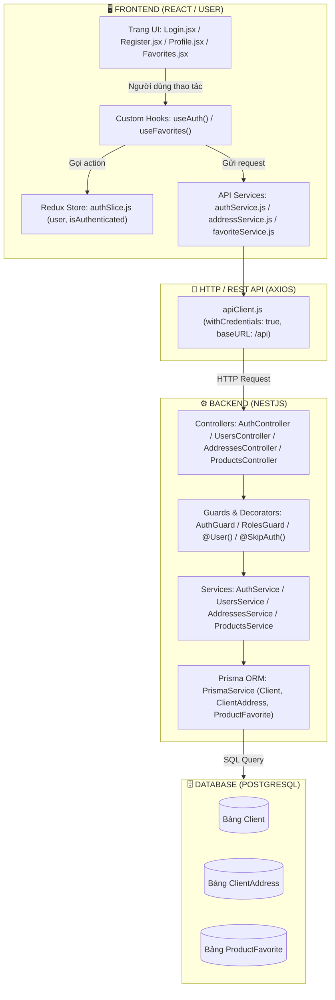

# 📚 TÀI LIỆU CHI TIẾT TỪNG DÒNG CODE: MODULE XÁC THỰC & TÀI KHOẢN (FRONTEND USER & BACKEND)

> **Dự án**: MIVA E-Commerce (HTTTDN)  
> **Đối tượng người đọc**: Sinh viên năm nhất, bắt đầu học lập trình Fullstack  
> **Phạm vi phân tích**: 
> 1. Đăng ký (Register) / Đăng nhập (Login) / Đăng xuất (Logout)  
> 2. Hồ sơ cá nhân (Profile)  
> 3. Sổ địa chỉ (Address Book)  
> 4. Danh sách yêu thích (Wishlist / Favorites)  
> 
> **Phương pháp tiếp cận**: Truy vết từ **Database (Prisma) ➡️ Backend Service ➡️ Backend Controller ➡️ Frontend API Service ➡️ Redux/React Query ➡️ Giao diện UI (JSX Component)**.

---

# 📑 MỤC LỤC
1. [Bản đồ Kiến trúc Fullstack của Module Xác thực & Tài khoản](#1-bản-đồ-kiến-trúc-fullstack)
2. [Chức năng 1: Đăng ký tài khoản (Register)](#2-chức-năng-1-đăng-ký-tài-khoản-register)
3. [Chức năng 2: Đăng nhập hệ thống (Login)](#3-chức-năng-2-đăng-nhập-hệ-thống-login)
4. [Chức năng 3: Đăng xuất hệ thống (Logout)](#4-chức-năng-3-đăng-xuất-hệ-thống-logout)
5. [Chức năng 4: Xem & Cập nhật Hồ sơ cá nhân (Profile)](#5-chức-năng-4-xem--cập-nhật-hồ-sơ-cá-nhân-profile)
6. [Chức năng 5: Quản lý Sổ địa chỉ nhận hàng (Address Book)](#6-chức-năng-5-quản-lý-sổ-địa-chỉ-nhận-hàng-address-book)
7. [Chức năng 6: Danh sách sản phẩm Yêu thích (Wishlist / Favorites)](#7-chức-năng-6-danh-sách-sản-phẩm-yêu-thích-wishlist--favorites)
8. [Tổng kết mô hình dữ liệu luân chuyển](#8-tổng-kết-mô-hình-dữ-liệu-luân-chuyển)

---

# 1. BẢN ĐỒ KIẾN TRÚC FULLSTACK



---

# 2. CHỨC NĂNG 1: ĐĂNG KÝ TÀI KHOẢN (REGISTER)

### 2.1. Phía Backend: Khởi tạo DTO, Service & Database Query

#### File DTO: `backend/src/app/auth/dto/sign.dto.ts`
DTO (Data Transfer Object) kiểm tra dữ liệu đầu vào bằng thư viện Zod:
```typescript
// Định nghĩa form đăng ký gồm các trường bắt buộc
export const SignUpSchema = z.object({
  fullName: z.string().min(2, 'Họ và tên tối thiểu 2 ký tự'),
  email: z.string().email('Email không đúng định dạng'),
  password: z.string().min(6, 'Mật khẩu tối thiểu 6 ký tự'),
  phone: z.string().optional(),
  address: z.string().optional(),
});
export class SignUpDto extends createZodDto(SignUpSchema) {}
```

#### File Controller: `backend/src/app/auth/auth.controller.ts`
```typescript
27:   @Post('sign-up')
28:   @SkipAuth()
29:   signUp(@Body() signUpDto: SignUpDto) {
30:     return this.authService.signUp(signUpDto);
31:   }
```
* **Dòng 27 (`@Post('sign-up')`)**: Đăng ký route HTTP phương thức `POST` tại `/api/auth/sign-up`.
* **Dòng 28 (`@SkipAuth()`)**: Bỏ qua bộ lọc kiểm tra đăng nhập (đăng ký tài khoản thì ai cũng được phép truy cập).
* **Dòng 29 (`signUp(@Body() signUpDto: SignUpDto)`)**: Tự động bóc tách phần `body` JSON do Frontend gửi lên và ép kiểu kiểm tra qua `SignUpDto`.
* **Dòng 30**: Ủy quyền việc xử lý nghiệp vụ cho `this.authService.signUp(...)`.

#### File Service: `backend/src/app/auth/auth.service.ts`
```typescript
87:   private async registerClient(signUpDto: SignUpDto) {
88:     const { email, password, ...otherInformation } = signUpDto;
89:     // 1. Kiểm tra email đã có người dùng nào đăng ký chưa
90:     await assertEmailAvailable(this.prisma, email);
91:     // 2. Mã hóa mật khẩu bằng thuật toán băm (Argon2/Bcrypt)
92:     const passwordHashed = await this.stringUtilService.hash(password);
93:     // 3. Ghi dữ liệu vào Database qua Prisma
94:     const userCreated = await this.clientsService.createClient({
95:       ...otherInformation,
96:       email,
97:       password: passwordHashed,
98:     } as any);
99:     // 4. Loại bỏ trường mật khẩu trước khi trả kết quả về cho client
100:    const { password: _password, ...userResponse } = userCreated;
101:    return userResponse;
102:  }
```
* **Dòng 90 (`assertEmailAvailable`)**: Chạy câu lệnh kiểm tra:
  ```sql
  SELECT id FROM "Client" WHERE email = $1 LIMIT 1;
  ```
  Nếu tìm thấy email đã tồn tại, lập tức ném lỗi `ConflictException('Email đã được sử dụng')`.
* **Dòng 91 (`hash(password)`)**: Tuyệt đối không lưu mật khẩu thô dạng `123456` mà băm thành chuỗi ký tự ngẫu nhiên an toàn: `$argon2id$v=19$m=65536...`.
* **Dòng 94 (`createClient`)**: Thực thi Prisma Query:
  ```typescript
  await this.prisma.client.create({
    data: { fullName, email, password: passwordHashed, phone }
  });
  ```
  Tương đương câu lệnh SQL:
  ```sql
  INSERT INTO "Client" ("id", "fullName", "email", "password", "phone", "createdAt") 
  VALUES (gen_random_uuid(), 'Nguyễn Văn A', 'a@gmail.com', '...', '0901234567', NOW()) 
  RETURNING *;
  ```

---

### 2.2. Phía Frontend: Gọi API và Render Giao diện

#### File API Service: `frontend/src/services/authService.js`
```javascript
8:   register: async (data) => {
9:     return await apiClient.post('/auth/sign-up', data);
10:  },
```
* Dòng 9: Sử dụng axios instance gửi gói tin HTTP `POST` đến `/api/auth/sign-up` kèm dữ liệu `data` từ form.

#### File Custom Hook: `frontend/src/hooks/useAuth.js`
```javascript
34:   const registerMutation = useMutation({
35:     mutationFn: (data) => authService.register(data),
36:     onSuccess: (_, data) => {
37:       navigate('/login', {
38:         replace: true,
39:         state: { registered: true, email: data.email.trim().toLowerCase() },
40:       });
41:     }
42:   });
```
* **Dòng 34-35**: Sử dụng `useMutation` từ `@tanstack/react-query` để quản lý trạng thái tải (`isPending`), thành công (`onSuccess`) và lỗi (`registerError`).
* **Dòng 36-41**: Khi đăng ký thành công, tự động chuyển người dùng sang trang `/login`, kèm cờ `registered: true` và `email` để tự điền sẵn.

#### File Giao diện: `frontend/src/pages/Auth/Register.jsx`
```jsx
8:   const [formData, setFormData] = useState({
9:     fullName: '', email: '', password: '', phone: '', address: ''
10:  });
...
17:  const handleSubmit = async (e) => {
18:    e.preventDefault();
19:    try {
20:      await register(formData);
21:    } catch (err) {}
22:  };
...
51:  <input
52:    required
53:    placeholder="Nguyễn Minh Anh"
54:    value={formData.fullName}
55:    onChange={e => setFormData({ ...formData, fullName: e.target.value })}
56:  />
```
* **Dòng 8-10**: Khởi tạo React State lưu trữ từng ký tự người dùng nhập vào Form.
* **Dòng 17-22**: Ngăn chặn hành vi reload trang mặc định của thẻ `<form>` (`e.preventDefault()`) và gọi hàm `register(formData)` từ hook.
* **Dòng 51-56**: Kỹ thuật **Controlled Component**: giá trị `value` được đồng bộ trực tiếp với state `formData.fullName`.

---

# 3. CHỨC NĂNG 2: ĐĂNG NHẬP HỆ THỐNG (LOGIN)

### 3.1. Phía Backend: Xác thực & Cấp Cookie JWT Token

#### File Controller: `backend/src/app/auth/auth.controller.ts`
```typescript
55:   async signIn(
56:     @Body() signInDto: SignInDto,
57:     @Req() request: Request,
58:     @Res({ passthrough: true }) response: Response,
59:   ) {
60:     const appRole = request.headers['x-app-role'] as string;
61:     const result = await this.authService.signIn(signInDto, appRole);
62:     const suffix = appRole ? `_${appRole}` : '';
63:     const accessKey = `${TokenKeys.ACCESS_TOKEN_KEY}${suffix}`;
64:     const refreshKey = `${TokenKeys.REFRESH_TOKEN_KEY}${suffix}`;
65: 
66:     response.cookie(accessKey, result.data.accessToken, {
67:       ...COOKIE_CONFIG_DEFAULT,
68:       maxAge: ms(CookiesToken.ACCESS_TOKEN_EXPIRE_IN),
69:     });
70: 
71:     response.cookie(refreshKey, result.data.refreshToken, {
72:       ...COOKIE_CONFIG_DEFAULT,
73:       maxAge: ms(CookiesToken.REFRESH_TOKEN_EXPIRE_IN),
74:     });
75:     return result;
76:   }
```
* **Dòng 58 (`@Res({ passthrough: true })`)**: Cho phép can thiệp ghi Header/Cookie vào HTTP Response nhưng vẫn để NestJS tự động format kết quả JSON trả về.
* **Dòng 61**: Gọi hàm `signIn` trong Service.
* **Dòng 66-74**: Ghi cặp Token vào trình duyệt người dùng qua **HttpOnly Cookie** (`accessToken` và `refreshToken`). Kỹ thuật này ngăn chặn hoàn toàn nguy cơ bị hacker đánh cắp token qua lỗ hổng XSS (Cross-Site Scripting).

#### File Service: `backend/src/app/auth/auth.service.ts`
```typescript
138:   const candidates = (await findAccountsByEmail(this.prisma, email))
139:     .filter(({ user }) => user.status === 'active' && !user.deletedAt);
...
144:   for (const candidate of candidates) {
145:     if (await this.stringUtilService.compare(password, candidate.user.password)) {
146:       user = candidate.user;
147:       role = candidate.role;
148:       break;
149:     }
150:   }
151:   if (!user) throw new UnauthorizedException('Email hoặc mật khẩu không đúng');
```
* **Database Query**: Quét trong bảng `Client` (và các vai trò khác):
  ```sql
  SELECT * FROM "Client" WHERE email = 'a@gmail.com' AND status = 'active' AND "deletedAt" IS NULL;
  ```
* **So khớp mật khẩu**: Dùng hàm `compare(password, hashedPassword)` để giải mã thuật toán băm một chiều. Nếu trùng khớp, sinh mã JWT chứa thông tin:
  ```json
  {
    "userID": "c4d3b84f-...",
    "userEmail": "a@gmail.com",
    "role": "client"
  }
  ```

---

### 3.2. Phía Frontend: Gửi yêu cầu, Nhận Session & Render

#### File Hook: `frontend/src/hooks/useAuth.js`
```javascript
25:   const loginMutation = useMutation({
26:     mutationFn: ({ email, password }) => authService.login(email, password),
27:     onSuccess: async () => {
28:       const userData = await authService.getProfile();
29:       dispatch(setCredentials(userData));
30:       navigate('/');
31:     },
32:   });
```
* **Dòng 26**: Gọi API `POST /api/auth/sign-in`.
* **Dòng 28-29**: Sau khi đăng nhập thành công và Cookie đã được lưu, lập tức gọi tiếp `authService.getProfile()` để lấy dữ liệu người dùng thật (tên, avatar, ví điểm) và lưu vào **Redux Toolkit** qua action `setCredentials(userData)`.
* **Dòng 30**: Chuyển hướng người dùng về trang chủ `/`.

#### File Redux Store: `frontend/src/features/auth/authSlice.js`
```javascript
12:   setCredentials: (state, action) => {
13:     state.user = action.payload;
14:     state.isAuthenticated = !!action.payload;
15:   },
```
* Lưu đối tượng người dùng vào `state.auth.user` và chuyển `isAuthenticated` thành `true`. Tất cả các component trên màn hình (như Header) sẽ lập tức đổi giao diện từ nút "Đăng nhập" sang hình Avatar và tên khách hàng.

---

# 4. CHỨC NĂNG 3: ĐĂNG XUẤT HỆ THỐNG (LOGOUT)

### 4.1. Phía Backend: Xóa Cookie
```typescript
// backend/src/app/auth/auth.controller.ts
123:   signOut(@Req() request: Request, @Res({ passthrough: true }) response: Response) {
133:     response.clearCookie(accessKey, COOKIE_CONFIG_DEFAULT);
134:     response.clearCookie(refreshKey, COOKIE_CONFIG_DEFAULT);
136:     return { message: 'Đăng xuất thành công' };
137:   }
```
* Backend ra lệnh cho trình duyệt: *"Hãy xóa ngay các cookie accessToken và refreshToken đi!"*.

### 4.2. Phía Frontend: Dọn dẹp Redux & Cache
```javascript
// frontend/src/hooks/useAuth.js
44:   const logoutMutation = useMutation({
45:     mutationFn: () => authService.logout(),
46:     onSettled: () => {
47:       dispatch(clearCredentials());
48:       queryClient.clear();
49:       navigate('/login');
50:     }
51:   });
```
* **Dòng 47 (`clearCredentials`)**: Xóa `user: null`, `isAuthenticated: false` trong Redux.
* **Dòng 48 (`queryClient.clear()`)**: Xóa sạch toàn bộ bộ nhớ đệm (Cache) của giỏ hàng, thông báo, đơn hàng để tránh rò rỉ dữ liệu khi người khác dùng máy.
* **Dòng 49**: Đưa người dùng về màn hình đăng nhập.

---

# 5. CHỨC NĂNG 4: XEM & CẬP NHẬT HỒ SƠ CÁ NHÂN (PROFILE)

### 5.1. Phía Backend: Lấy Profile & Cập nhật
```typescript
// backend/src/app/users/users.controller.ts
37:   @Get('profile')
38:   @Roles('admin', 'client', 'vendor', 'employee')
39:   getProfile(@User() user: UserInfo) {
40:     return this.usersService.getUser(user.userID);
41:   }
```
* **`@User() user: UserInfo`**: Custom Decorator tự động giải mã JWT Token từ Cookie để lấy ra `userID` của người đang gửi request.
* **Database Query trong `users.service.ts`**:
  ```typescript
  return this.prisma.client.findUnique({
    where: { id: user.userID },
    select: {
      id: true, fullName: true, email: true, phone: true,
      avatarUrl: true, gender: true, dateOfBirth: true, loyaltyPoints: true,
      addresses: { where: { deletedAt: null, isDefault: true } }
    }
  });
  ```
  Câu lệnh SQL tương ứng:
  ```sql
  SELECT c.id, c."fullName", c.email, c.phone, c."avatarUrl", c.gender, c."dateOfBirth", c."loyaltyPoints"
  FROM "Client" c
  WHERE c.id = '...' LIMIT 1;
  ```

#### Cập nhật hồ sơ (`PATCH /api/users/profile`)
```typescript
// backend/src/app/users/users.service.ts
442:   const updated = await this.prisma.client.update({
443:     where: { id },
444:     data: clientData,
445:   });
```
* Lọc sạch dữ liệu, không cho phép client cập nhật các trường cấm (như `role`, `loyaltyPoints` hay `password`). Thực thi lệnh SQL:
  ```sql
  UPDATE "Client" 
  SET "fullName" = $1, "phone" = $2, "gender" = $3, "dateOfBirth" = $4, "updatedAt" = NOW() 
  WHERE "id" = $5;
  ```

---

### 5.2. Phía Frontend: Render Màn hình `Profile.jsx`

#### Hiển thị thông tin (View Mode):
```jsx
// frontend/src/pages/Account/Profile.jsx
34: function InfoRow({ icon: Icon, label, value }) {
35:   return (
36:     <div className="flex items-center gap-4">
37:       <div className="w-12 h-12 rounded-full bg-primary/10 flex items-center justify-center text-primary shrink-0">
38:         <Icon className="w-6 h-6" />
39:       </div>
40:       <div className="min-w-0">
41:         <p className="text-sm text-light-muted">{label}</p>
42:         <p className="font-semibold text-light-text">{value || 'Chưa cập nhật'}</p>
43:       </div>
44:     </div>
45:   );
46: }
```
* Hàm component phụ `InfoRow` nhận vào icon (Mail, User, Phone, MapPin), nhãn (label) và giá trị (value) để render thông tin hồ sơ sạch đẹp, gọn gàng.

#### Chế độ Chỉnh sửa (Edit Mode) & Validation:
```jsx
// Khi bấm nút "Chỉnh sửa hồ sơ":
66:   const [form, setForm] = useState({ fullName: '', phone: '', gender: '', dateOfBirth: '' });
...
// Kiểm tra số điện thoại hợp lệ bằng Regex trước khi gửi:
18:   const PHONE_REGEX = /^(0|\+84)\d{9,10}$/;
...
// Gọi API cập nhật:
await updateProfile({
  fullName: form.fullName.trim(),
  phone: form.phone.trim(),
  gender: form.gender,
  dateOfBirth: form.dateOfBirth
});
```

---

# 6. CHỨC NĂNG 5: QUẢN LÝ SỔ ĐỊA CHỈ NHẬN HÀNG (ADDRESS BOOK)

### 6.1. Phía Backend: Khởi tạo CRUD Sổ địa chỉ
Toàn bộ logic nằm trong [`AddressesController`](file:///c:/HTTT/htttdn/backend/src/app/addresses/addresses.controller.ts) và [`AddressesService`](file:///c:/HTTT/htttdn/backend/src/app/addresses/addresses.service.ts).

#### Lấy danh sách địa chỉ (`GET /api/addresses`):
```typescript
27:   async getUserAddresses(clientId: string) {
28:     return this.prismaService.clientAddress.findMany({
29:       where: { clientId, deletedAt: null },
30:       orderBy: [
31:         { isDefault: 'desc' }, // Địa chỉ mặc định lên đầu
32:         { createdAt: 'desc' },
33:       ]});
34:   }
```
* **Database Query (SQL)**:
  ```sql
  SELECT * FROM "ClientAddress"
  WHERE "clientId" = $1 AND "deletedAt" IS NULL
  ORDER BY "isDefault" DESC, "createdAt" DESC;
  ```

#### Thêm mới địa chỉ & Đảm bảo chỉ có 1 địa chỉ mặc định:
```typescript
13:   async createAddress(clientId: string, data: CreateAddressDto) {
14:     // Nếu người dùng chọn địa chỉ này làm mặc định:
15:     if (data.isDefault) {
16:       await this.prismaService.clientAddress.updateMany({
17:         where: { clientId, deletedAt: null },
18:         data: { isDefault: false } // Đổi tất cả các địa chỉ cũ về không mặc định
19:       });
20:     }
21:     return this.prismaService.clientAddress.create({
22:       data: { ...data, clientId }
23:     });
24:   }
```

---

### 6.2. Phía Frontend: Service & Tích hợp vào Profile / Checkout

#### File Service: `frontend/src/services/addressService.js`
```javascript
3: export const addressService = {
4:   getAddresses: async () => apiClient.get('/addresses'),
8:   getAddressById: async (id) => apiClient.get(`/addresses/${id}`),
12:  createAddress: async (data) => apiClient.post('/addresses', data),
16:  updateAddress: async (id, data) => apiClient.patch(`/addresses/${id}`, data),
20:  deleteAddress: async (id) => apiClient.delete(`/addresses/${id}`)
23: };
```

#### Sử dụng trong `Profile.jsx`:
```javascript
53:   const { data: addressRes } = useQuery({
54:     queryKey: ['addresses'],
55:     queryFn: () => addressService.getAddresses(),
56:     enabled: !!user,
57:   });
62:   const defaultAddress = addresses.find((a) => a.isDefault) || addresses[0] || null;
```
* Sử dụng `useQuery` để tự động tải danh sách địa chỉ ngay khi biến `user` tồn tại.
* Dùng hàm nối chuỗi `joinAddress()` để ghép: `addressLine + ward + district + province` thành chuỗi hoàn chỉnh: *"123 Nguyễn Huệ, Phường Bến Nghé, Quận 1, TP. Hồ Chí Minh"*.

---

# 7. CHỨC NĂNG 6: DANH SÁCH SẢN PHẨM YÊU THÍCH (WISHLIST)

### 7.1. Phía Backend: Controller tiếp nhận Request từ Frontend

Nhiều bạn mới học thường thắc mắc: *"Chức năng này Controller nằm ở đâu?"*. Trong dự án MIVA, các API liên quan đến yêu thích được đặt bên trong **`ProductsController`** ([`backend/src/app/products/products.controller.ts`](file:///c:/HTTT/htttdn/backend/src/app/products/products.controller.ts#L116-L145)) và bổ trợ bởi **`FavoritesController`** ([`backend/src/app/products/favorites.controller.ts`](file:///c:/HTTT/htttdn/backend/src/app/products/favorites.controller.ts)):

#### Chi tiết Code trong `backend/src/app/products/products.controller.ts`:
```typescript
116:   @Get('favorites')
117:   @Roles('client')
118:   listFavorites(@CurrentUser() user: UserInfo) {
119:     return this.productService.listFavorites(user.userID);
120:   }
121: 
122:   @Get(':id/favorite-status')
123:   @Roles('client')
124:   favoriteStatus(
125:     @Param('id', ParseUUIDPipe) id: string,
126:     @CurrentUser() user: UserInfo,
127:   ) {
128:     return this.productService.favoriteStatus(id, user.userID);
129:   }
130: 
131:   @Post(':id/favorite')
132:   @Roles('client')
133:   addFavorite(
134:     @Param('id', ParseUUIDPipe) id: string,
135:     @CurrentUser() user: UserInfo,
136:   ) {
137:     return this.productService.addFavorite(id, user.userID);
138:   }
139: 
140:   @Delete(':id/favorite')
141:   @Roles('client')
142:   removeFavorite(
143:     @Param('id', ParseUUIDPipe) id: string,
144:     @CurrentUser() user: UserInfo,
145:   ) {
146:     return this.productService.removeFavorite(id, user.userID);
147:   }
```
* **Dòng 116-120 (`@Get('favorites')`)**: Route `GET /api/products/favorites`. Lấy danh sách sản phẩm yêu thích của khách hàng đang đăng nhập (`user.userID`).
* **Dòng 122-129 (`@Get(':id/favorite-status')`)**: Kiểm tra xem khách hàng đã thích sản phẩm có ID này chưa (để hiển thị trái tim đỏ hay trái tim rỗng trên giao diện).
* **Dòng 130-137 (`@Post(':id/favorite')`)**: Thêm sản phẩm vào danh sách yêu thích.
* **Dòng 138-145 (`@Delete(':id/favorite')`)**: Hủy bỏ yêu thích sản phẩm.
* `@Roles('client')`: Bắt buộc người gửi request phải là khách hàng đã đăng nhập, nếu chưa đăng nhập sẽ bị chặn bởi `AccessControlGuard` (lỗi `401 Unauthorized` hoặc `403 Forbidden`).

---

### 7.2. Phía Backend: Xử lý Service & Truy vấn Database (Prisma)

Bảng Database `ProductFavorite` lưu mối quan hệ giữa người dùng (`clientId`) và sản phẩm (`productId`):
```prisma
model ProductFavorite {
  id        String   @id @default(uuid())
  clientId  String
  productId String
  createdAt DateTime @default(now())

  client    Client   @relation(fields: [clientId], references: [id])
  product   Product  @relation(fields: [productId], references: [id])

  @@unique([clientId, productId])
}
```

#### Logic Thêm & Xóa trong `backend/src/app/products/products.service.ts`:
```typescript
// 1. Thêm vào yêu thích (Sử dụng upsert để tránh trùng lặp)
274:   const favorite = await this.prismaService.productFavorite.upsert({
275:     where: { clientId_productId: { clientId, productId } },
276:     create: { clientId, productId },
277:     update: {},
278:   });

// 2. Bỏ thích (Xóa bản ghi)
283:   await this.prismaService.productFavorite.deleteMany({
284:     where: { clientId, productId },
285:   });

// 3. Lấy toàn bộ danh sách sản phẩm đã yêu thích
296:   const favorites = await this.prismaService.productFavorite.findMany({
297:     where: { clientId },
298:     include: {
299:       product: {
300:         include: { variants: true, images: true, category: true }
301:       }
302:     }
303:   });
```
* **Database Query (SQL)**:
  ```sql
  SELECT f.id, f."createdAt", p.* 
  FROM "ProductFavorite" f
  JOIN "Product" p ON f."productId" = p.id
  WHERE f."clientId" = $1;
  ```

---

### 7.2. Phía Frontend: Hook `useFavorites` và Render `Favorites.jsx`

#### File Hook: `frontend/src/hooks/useFavorites.js`
```javascript
8:   return useQuery({
9:     queryKey: ['favorites'],
10:    queryFn: async () => {
11:      const data = await favoriteService.getFavorites();
12:      return data?.list || data || [];
13:    },
14:    enabled: isAuthenticated,
15:  });
```
* Thuộc tính `enabled: isAuthenticated` đảm bảo: **Chỉ khi người dùng đã đăng nhập thì mới gửi request lấy danh sách yêu thích**.

#### File Giao diện: `frontend/src/pages/Account/Favorites.jsx`
```jsx
7:   const { data: favorites = [], isLoading } = useFavorites();
...
18:  <div className="max-w-7xl mx-auto px-4 py-8">
19:    <h1 className="text-2xl font-bold mb-8">Sản phẩm yêu thích</h1>
20:    {favorites.length === 0 ? (
21:      <div className="text-center py-12">
22:        <Heart className="mx-auto h-12 w-12 text-slate-300 mb-4" />
23:        <h3>Chưa có sản phẩm nào</h3>
24:      </div>
25:    ) : (
26:      <div className="grid grid-cols-2 gap-4 sm:grid-cols-3 lg:grid-cols-4">
27:        {favorites.map((favorite) => (
28:          <ProductCard key={favorite.id} product={favorite.product || favorite} />
29:        ))}
30:      </div>
31:    )}
32:  </div>
```
* **Dòng 7**: Lấy danh sách sản phẩm yêu thích và cờ trạng thái `isLoading`.
* **Dòng 20-25 (Conditional Rendering)**: Nếu danh sách rỗng (`length === 0`), render giao diện trống có hình trái tim xám thông báo *"Chưa có sản phẩm nào"*.
* **Dòng 26-31**: Nếu có sản phẩm, dùng hàm `.map()` để lặp qua từng phần tử và tái sử dụng component [`ProductCard`](file:///c:/HTTT/htttdn/frontend/src/components/product/ProductCard/ProductCard.jsx) để hiển thị thẻ sản phẩm (ảnh, giá tiền, số sao, nút thêm vào giỏ).

---

# 8. TỔNG KẾT MÔ HÌNH DỮ LIỆU LUÂN CHUYỂN

| Bước | Thành phần phụ trách | Dữ liệu đầu vào (Input) | Thao tác thực hiện | Dữ liệu đầu ra (Output) |
|:---:|:---|:---|:---|:---|
| **1. UI Form** | `Login.jsx` / `Register.jsx` | Người dùng nhập chuột & phím | `setFormData({ email, password })` | Đối tượng JavaScript thuần |
| **2. API Call** | `apiClient.js` (Axios) | `authService.login(email, pass)` | Gửi HTTP POST kèm `withCredentials: true` | Gói tin HTTP Network Request |
| **3. Controller**| `AuthController.signIn` | Nhận Request body | Validate dữ liệu qua `SignInDto` | Gọi `AuthService` |
| **4. Service** | `AuthService.signIn` | `email`, `password` | Tìm tài khoản & băm so khớp `compare()` | Chuỗi AccessToken & RefreshToken |
| **5. Database** | `PrismaService` | `where: { email }` | Thực thi SQL Query trong PostgreSQL | Bản ghi Client từ bảng dữ liệu |
| **6. Phản hồi**| `response.cookie(...)` | Tokens từ Service | Thiết lập HttpOnly Cookie vào header | Mã trạng thái `200 OK` |
| **7. Quản lý State**| `authSlice.js` (Redux) | Dữ liệu Profile trả về | `dispatch(setCredentials(user))` | Toàn bộ ứng dụng biết User đã đăng nhập |
| **8. Render UI**| React Components | Redux State & React Query | Render lại Header, Avatar, Profile, Giỏ hàng | Màn hình giao diện đổi sang trạng thái đã đăng nhập |

---
*Tài liệu được tạo tự động bởi trợ lý kỹ thuật AI dành riêng cho dự án MIVA E-Commerce (HTTTDN).*
