# Sơ đồ UML / ERD Cơ sở dữ liệu hệ thống (E-Commerce Platform)

Tài liệu này cung cấp toàn bộ mã nguồn biểu đồ UML / ERD của cơ sở dữ liệu dựa trên mô hình định nghĩa trong [schema.prisma](../prisma/schema.prisma).

Hệ thống bao gồm **31 thực thể (Entities)** được tổ chức thành **6 phân hệ chính**:
1. **Phân hệ Người dùng & Xác thực (Users & Authentication)**: `Admin`, `Employee`, `Client`, `ClientAddress`, `Vendor`.
2. **Phân hệ Nhân sự & Tiền lương (HR & Payroll)**: `EmployeeSalaryHistory`, `EmployeeAttendance`, `EmployeePayroll`.
3. **Phân hệ Sản phẩm & Danh mục (Catalog & Products)**: `Category`, `Product`, `ProductColor`, `ProductVariant`, `ProductFavorite`, `Review`.
4. **Phân hệ Giỏ hàng & Voucher (Cart & Promotions)**: `Cart`, `CartItem`, `Voucher`, `VoucherDetail`.
5. **Phân hệ Đơn hàng, Thanh toán & Vận chuyển (Orders, Payment & Logistics)**: `Order`, `OrderDetail`, `VendorOrder`, `Payment`, `OrderStatusHistory`, `Shipment`, `ShipmentEvent`.
6. **Phân hệ Khảo sát & Thông báo (Surveys & Notifications)**: `Survey`, `SurveyQuestion`, `SurveyOption`, `SurveyResponse`, `SurveyAnswer`, `Notification`.

---

## 1. Sơ đồ Mermaid ERD (Hiển thị trực tiếp trong Markdown/GitHub)

```mermaid
erDiagram
    Admin ||--o{ Employee : "creates"
    Admin ||--o{ EmployeeSalaryHistory : "modifies"
    Employee ||--o{ EmployeeSalaryHistory : "has"
    Employee ||--o{ EmployeeAttendance : "has"
    Employee ||--o{ EmployeePayroll : "receives"

    Client ||--o| Cart : "owns"
    Cart ||--|{ CartItem : "contains"
    Client ||--o{ ClientAddress : "has"
    Client ||--o{ ProductFavorite : "favorites"
    Client ||--o{ Review : "writes"

    Category ||--o{ Product : "classifies"
    Vendor ||--o{ Product : "sells"
    Product ||--|{ ProductColor : "has"
    ProductColor ||--|{ ProductVariant : "has"
    ProductVariant ||--o{ CartItem : "in"
    Product ||--o{ ProductFavorite : "favorited in"
    Product ||--o{ Review : "reviewed in"

    Client ||--o{ Order : "places"
    Order ||--|{ OrderDetail : "contains"
    ProductVariant ||--o{ OrderDetail : "purchased in"
    OrderDetail ||--o| Review : "yields"

    Order ||--o{ VendorOrder : "splits into"
    Vendor ||--o{ VendorOrder : "fulfills"
    VendorOrder ||--o{ OrderDetail : "includes"
    Order ||--o{ Shipment : "ships via"
    VendorOrder ||--o| Shipment : "dispatched via"
    Employee ||--o{ Shipment : "delivers as carrier"
    Shipment ||--|{ ShipmentEvent : "tracks"

    Order ||--|| Payment : "paid via"
    Order ||--|{ OrderStatusHistory : "tracked in"
    Admin ||--o{ OrderStatusHistory : "updated by"
    Employee ||--o{ OrderStatusHistory : "updated by"
    Client ||--o{ OrderStatusHistory : "updated by"
    Vendor ||--o{ OrderStatusHistory : "updated by"

    Admin ||--o{ Voucher : "creates"
    Vendor ||--o{ Voucher : "creates"
    Voucher ||--o{ VoucherDetail : "applied in"
    Product ||--o{ VoucherDetail : "targets"
    Order ||--o{ VoucherDetail : "uses"

    Admin ||--o{ Survey : "creates"
    Vendor ||--o{ Survey : "creates"
    Survey ||--|{ SurveyQuestion : "has"
    SurveyQuestion ||--o{ SurveyOption : "options"
    Survey ||--o{ SurveyResponse : "collects"
    Client ||--o{ SurveyResponse : "answers"
    Order ||--o{ SurveyResponse : "triggered by"
    SurveyResponse ||--|{ SurveyAnswer : "includes"
    SurveyQuestion ||--o{ SurveyAnswer : "referenced by"
    SurveyOption ||--o{ SurveyAnswer : "selected in"

    Admin ||--o{ Notification : "receives"
    Client ||--o{ Notification : "receives"
    Vendor ||--o{ Notification : "receives"
    Survey ||--o{ Notification : "relates to"
    SurveyResponse ||--o| Notification : "triggers"

    Admin {
        uuid id PK
        string fullName
        string email UK
        string password
        string phone
        string avatarUrl
        string department
        string status
        datetime createdAt
        datetime updatedAt
    }

    Employee {
        uuid id PK
        string employeeCode UK
        string fullName
        string email UK
        string password
        string department
        string position
        string employmentType
        decimal salary
        date hireDate
        string status
        uuid adminId FK
    }

    Client {
        uuid id PK
        string fullName
        string email UK
        string password
        string phone
        int loyaltyPoints
        string status
        datetime createdAt
    }

    Vendor {
        uuid id PK
        string fullName
        string email UK
        string storeName
        string taxId
        string subscriptionPlan
        decimal commissionRate
        string approvalStatus
    }

    Product {
        uuid id PK
        uuid categoryId FK
        uuid vendorId FK
        string name
        string slug UK
        string status
    }

    Order {
        uuid id PK
        string orderCode UK
        uuid clientId FK
        decimal subtotalAmount
        decimal discountAmount
        decimal shippingFee
        decimal totalAmount
        string status
        datetime createdAt
    }

    Payment {
        uuid id PK
        uuid orderId FK
        string method
        decimal amount
        string status
        string transactionCode UK
    }

    Shipment {
        uuid id PK
        string trackingNumber UK
        uuid orderId FK
        uuid vendorOrderId FK
        uuid carrierId FK
        string status
    }

    Voucher {
        uuid id PK
        string code UK
        string name
        string scope
        string discountType
        decimal discountValue
        string status
    }

    Survey {
        uuid id PK
        string title
        string scope
        string audienceType
        string triggerType
        string status
    }
```

---

## 2. Mã nguồn chi tiết theo định dạng PlantUML (Đầy đủ thuộc tính & quan hệ)

Tập tin nguồn gốc: [database-erd.puml](./database-erd.puml). Bạn có thể dùng extension **PlantUML** trong VS Code hoặc trang **PlantText.com** / **StarUML** để xuất file ảnh PNG/SVG/PDF.

```plantuml
@startuml Database_ERD
!theme plain
hide circle
skinparam linetype ortho
skinparam roundcorner 5

' ==========================================
' ENTITIES: USERS & AUTH
' ==========================================
entity Admin {
  * id : uuid <<PK>>
  --
  * fullName : varchar(255)
  * email : varchar(255) <<UK>>
  * password : varchar(255)
  phone : varchar(255)
  avatarUrl : varchar(1000)
  department : varchar(255)
  * status : UserStatus = active
  * createdAt : timestamp
  * updatedAt : timestamp
  deletedAt : timestamp
}

entity Employee {
  * id : uuid <<PK>>
  --
  * employeeCode : varchar(50) <<UK>>
  * fullName : varchar(255)
  * email : varchar(255) <<UK>>
  * password : varchar(255)
  phone : varchar(50)
  avatarUrl : varchar(1000)
  dateOfBirth : date
  gender : Gender
  citizenId : varchar(50)
  address : varchar(500)
  * department : varchar(100)
  * position : varchar(100)
  * employmentType : EmploymentType = full_time
  * salary : decimal(12,2) = 0
  hourlyRate : decimal(12,2)
  * hireDate : date
  * status : UserStatus = active
  * assignedOrderScope : varchar(100) = "assigned_orders"
  permissions : json
  adminId : uuid <<FK>>
  * createdAt : timestamp
  * updatedAt : timestamp
  deletedAt : timestamp
}

entity Client {
  * id : uuid <<PK>>
  --
  * fullName : varchar(255)
  * email : varchar(255) <<UK>>
  * password : varchar(255)
  phone : varchar(255)
  avatarUrl : varchar(1000)
  dateOfBirth : date
  gender : Gender
  * loyaltyPoints : int = 0
  * status : UserStatus = active
  * createdAt : timestamp
  * updatedAt : timestamp
  deletedAt : timestamp
}

entity ClientAddress {
  * id : uuid <<PK>>
  --
  * clientId : uuid <<FK>>
  * receiverName : varchar(255)
  * phone : varchar(50)
  * addressLine : varchar(500)
  ward : varchar(255)
  district : varchar(255)
  province : varchar(255)
  label : varchar(100)
  * isDefault : boolean = false
  * createdAt : timestamp
  * updatedAt : timestamp
  deletedAt : timestamp
}

entity Vendor {
  * id : uuid <<PK>>
  --
  * fullName : varchar(255)
  * email : varchar(255) <<UK>>
  * password : varchar(255)
  phone : varchar(255)
  avatarUrl : varchar(1000)
  storeName : varchar(255)
  taxId : varchar(100)
  * status : UserStatus = active
  subscriptionPlan : varchar(50) = "1_year"
  subscriptionFee : decimal(12,2) = 1200000
  subscriptionExpiresAt : timestamp
  * commissionRate : decimal(5,2) = 8.00
  * approvalStatus : varchar(50) = "approved"
  approvedAt : timestamp
  approvedBy : varchar(255)
  rejectedReason : varchar(500)
  * renewalRequested : boolean = false
  renewalPlan : varchar(50)
  renewalRequestedAt : timestamp
  * createdAt : timestamp
  * updatedAt : timestamp
  deletedAt : timestamp
}

' ==========================================
' ENTITIES: HR & EMPLOYEE MANAGEMENT
' ==========================================
entity EmployeeSalaryHistory {
  * id : uuid <<PK>>
  --
  * employeeId : uuid <<FK>>
  oldSalary : decimal(12,2)
  * newSalary : decimal(12,2)
  oldHourlyRate : decimal(12,2)
  newHourlyRate : decimal(12,2)
  * employmentType : EmploymentType = full_time
  * effectiveDate : date
  reason : varchar(500)
  adminId : uuid <<FK>>
  * createdAt : timestamp
}

entity EmployeeAttendance {
  * id : uuid <<PK>>
  --
  * employeeId : uuid <<FK>>
  * date : date
  checkIn : timestamp
  checkOut : timestamp
  hoursWorked : decimal(5,2)
  * status : AttendanceStatus = present
  note : varchar(500)
  * createdAt : timestamp
  * updatedAt : timestamp
}

entity EmployeePayroll {
  * id : uuid <<PK>>
  --
  * employeeId : uuid <<FK>>
  * month : int
  * year : int
  * employmentType : EmploymentType = full_time
  * baseSalary : decimal(12,2) = 0
  hourlyRate : decimal(12,2)
  totalHours : decimal(6,2)
  * allowances : decimal(12,2) = 0
  * deductions : decimal(12,2) = 0
  * bonus : decimal(12,2) = 0
  * netSalary : decimal(12,2)
  * status : PayrollStatus = draft
  paidAt : timestamp
  notes : varchar(1000)
  * createdAt : timestamp
  * updatedAt : timestamp
}

' ==========================================
' ENTITIES: PRODUCT & CATALOG
' ==========================================
entity Category {
  * id : uuid <<PK>>
  --
  * name : varchar(255)
  * slug : varchar(255) <<UK>>
  * createdAt : timestamp
  * updatedAt : timestamp
  deletedAt : timestamp
}

entity Product {
  * id : uuid <<PK>>
  --
  * categoryId : uuid <<FK>>
  vendorId : uuid <<FK>>
  * name : varchar(255)
  * slug : varchar(255) <<UK>>
  description : text
  * status : ProductStatus = draft
  * createdAt : timestamp
  * updatedAt : timestamp
  deletedAt : timestamp
}

entity ProductColor {
  * id : uuid <<PK>>
  --
  * productId : uuid <<FK>>
  * color : varchar(100)
  * imageUrls : string[]
  * createdAt : timestamp
  * updatedAt : timestamp
  deletedAt : timestamp
}

entity ProductVariant {
  * id : uuid <<PK>>
  --
  * productColorId : uuid <<FK>>
  * size : varchar(50)
  * stock : int = 0
  * price : decimal(12,2)
  * createdAt : timestamp
  * updatedAt : timestamp
  deletedAt : timestamp
}

entity ProductFavorite {
  * id : uuid <<PK>>
  --
  * clientId : uuid <<FK>>
  * productId : uuid <<FK>>
  * createdAt : timestamp
}

entity Review {
  * id : uuid <<PK>>
  --
  * clientId : uuid <<FK>>
  * productId : uuid <<FK>>
  * orderDetailId : uuid <<FK, UK>>
  content : text
  * rating : int
  * createdAt : timestamp
  * updatedAt : timestamp
  deletedAt : timestamp
}

' ==========================================
' ENTITIES: CART & VOUCHERS
' ==========================================
entity Cart {
  * id : uuid <<PK>>
  --
  * clientId : uuid <<FK, UK>>
  * createdAt : timestamp
  * updatedAt : timestamp
  deletedAt : timestamp
}

entity CartItem {
  * id : uuid <<PK>>
  --
  * cartId : uuid <<FK>>
  * productVariantId : uuid <<FK>>
  * quantity : int = 1
  * createdAt : timestamp
  * updatedAt : timestamp
}

entity Voucher {
  * id : uuid <<PK>>
  --
  adminId : uuid <<FK>>
  vendorId : uuid <<FK>>
  * code : varchar(50) <<UK>>
  * name : varchar(255)
  * scope : VoucherScope
  * discountType : DiscountType
  * discountValue : decimal(12,2)
  minOrderAmount : decimal(12,2)
  maxDiscountAmount : decimal(12,2)
  * quantity : int
  * usedQuantity : int = 0
  * perUserLimit : int = 1
  * startDate : timestamp
  * endDate : timestamp
  * status : VoucherStatus = draft
  * createdAt : timestamp
  * updatedAt : timestamp
  deletedAt : timestamp
}

entity VoucherDetail {
  * id : uuid <<PK>>
  --
  * voucherId : uuid <<FK>>
  productId : uuid <<FK>>
  orderId : uuid <<FK>>
  eligibleAmount : decimal(12,2)
  discountAmount : decimal(12,2)
  sequence : int
  * createdAt : timestamp
  reversedAt : timestamp
}

' ==========================================
' ENTITIES: ORDERS, PAYMENTS & LOGISTICS
' ==========================================
entity Order {
  * id : uuid <<PK>>
  --
  * orderCode : varchar(50) <<UK>>
  * clientId : uuid <<FK>>
  * subtotalAmount : decimal(12,2) = 0
  * discountAmount : decimal(12,2) = 0
  * shippingFee : decimal(12,2) = 0
  * totalAmount : decimal(12,2)
  * status : OrderStatus = pending
  notes : varchar(1000)
  receiverName : varchar(255)
  receiverPhone : varchar(50)
  shippingAddress : varchar(500)
  * createdAt : timestamp
  * updatedAt : timestamp
  cancelledAt : timestamp
}

entity OrderDetail {
  * id : uuid <<PK>>
  --
  * orderId : uuid <<FK>>
  * productVariantId : uuid <<FK>>
  * quantity : int
  * price : decimal(12,2)
  productName : varchar(255)
  colorName : varchar(100)
  sizeName : varchar(100)
  imageUrl : varchar(1000)
  vendorOrderId : uuid <<FK>>
}

entity VendorOrder {
  * id : uuid <<PK>>
  --
  * vendorOrderCode : varchar(50) <<UK>>
  * orderId : uuid <<FK>>
  * vendorId : uuid <<FK>>
  * subtotalAmount : decimal(12,2) = 0
  * shippingFee : decimal(12,2) = 0
  * totalAmount : decimal(12,2) = 0
  * status : VendorOrderStatus = pending
  notes : varchar(1000)
  * createdAt : timestamp
  * updatedAt : timestamp
}

entity Payment {
  * id : uuid <<PK>>
  --
  * orderId : uuid <<FK, UK>>
  * method : PaymentMethod
  * amount : decimal(12,2) = 0
  * status : PaymentStatus = pending
  transactionCode : varchar(255) <<UK>>
  gateway : varchar(100)
  gatewayResponse : json
  paidAt : timestamp
  failedAt : timestamp
  * createdAt : timestamp
  * updatedAt : timestamp
}

entity OrderStatusHistory {
  * id : uuid <<PK>>
  --
  * orderId : uuid <<FK>>
  adminId : uuid <<FK>>
  clientId : uuid <<FK>>
  vendorId : uuid <<FK>>
  employeeId : uuid <<FK>>
  fromStatus : OrderStatus
  * toStatus : OrderStatus
  note : varchar(1000)
  * createdAt : timestamp
}

entity Shipment {
  * id : uuid <<PK>>
  --
  * trackingNumber : varchar(50) <<UK>>
  * orderId : uuid <<FK>>
  vendorOrderId : uuid <<FK, UK>>
  carrierId : uuid <<FK>>
  * carrierType : varchar(50) = "employee"
  * status : ShipmentStatus = pending
  pickupAddress : varchar(500)
  shippingAddress : varchar(500)
  receiverName : varchar(255)
  receiverPhone : varchar(50)
  estimatedDelivery : timestamp
  deliveredAt : timestamp
  failedReason : varchar(500)
  notes : varchar(1000)
  * createdAt : timestamp
  * updatedAt : timestamp
}

entity ShipmentEvent {
  * id : uuid <<PK>>
  --
  * shipmentId : uuid <<FK>>
  * status : ShipmentStatus
  location : varchar(255)
  description : varchar(500)
  actorRole : varchar(50)
  actorId : uuid
  * createdAt : timestamp
}

' ==========================================
' ENTITIES: SURVEY & NOTIFICATION
' ==========================================
entity Survey {
  * id : uuid <<PK>>
  --
  adminId : uuid <<FK>>
  vendorId : uuid <<FK>>
  * title : varchar(255)
  description : text
  imageUrl : varchar(1000)
  * scope : SurveyScope = platform
  * audienceType : SurveyAudienceType
  * triggerType : SurveyTriggerType = manual
  * status : SurveyStatus = draft
  startDate : timestamp
  endDate : timestamp
  * createdAt : timestamp
  * updatedAt : timestamp
  deletedAt : timestamp
}

entity SurveyQuestion {
  * id : uuid <<PK>>
  --
  * surveyId : uuid <<FK>>
  * question : text
  * type : SurveyQuestionType
  * required : boolean = false
  * position : int
  * createdAt : timestamp
  * updatedAt : timestamp
}

entity SurveyOption {
  * id : uuid <<PK>>
  --
  * questionId : uuid <<FK>>
  * content : varchar(500)
  * position : int
  * createdAt : timestamp
}

entity SurveyResponse {
  * id : uuid <<PK>>
  --
  * surveyId : uuid <<FK>>
  * clientId : uuid <<FK>>
  orderId : uuid <<FK>>
  * deliveryKey : varchar(255) <<UK>>
  * status : SurveyResponseStatus = pending
  notifiedAt : timestamp
  openedAt : timestamp
  submittedAt : timestamp
  skippedAt : timestamp
  expiresAt : timestamp
  * createdAt : timestamp
  * updatedAt : timestamp
}

entity SurveyAnswer {
  * id : uuid <<PK>>
  --
  * responseId : uuid <<FK>>
  * questionId : uuid <<FK>>
  optionId : uuid <<FK>>
  textAnswer : text
  ratingValue : int
  * createdAt : timestamp
}

entity Notification {
  * id : uuid <<PK>>
  --
  adminId : uuid <<FK>>
  clientId : uuid <<FK>>
  vendorId : uuid <<FK>>
  surveyId : uuid <<FK>>
  surveyResponseId : uuid <<FK, UK>>
  * type : NotificationType
  * title : varchar(255)
  content : text
  data : json
  * isRead : boolean = false
  readAt : timestamp
  expiresAt : timestamp
  * createdAt : timestamp
}

' ==========================================
' RELATIONSHIPS
' ==========================================
Admin ||--o{ Employee : "creates"
Admin ||--o{ EmployeeSalaryHistory : "modifies"
Employee ||--o{ EmployeeSalaryHistory : "has"
Employee ||--o{ EmployeeAttendance : "has"
Employee ||--o{ EmployeePayroll : "receives"

Client ||--o| Cart : "owns"
Cart ||--|{ CartItem : "contains"
Client ||--o{ ClientAddress : "has"
Client ||--o{ ProductFavorite : "favorites"
Client ||--o{ Review : "writes"

Category ||--o{ Product : "classifies"
Vendor ||--o{ Product : "sells"
Product ||--|{ ProductColor : "has"
ProductColor ||--|{ ProductVariant : "has"
ProductVariant ||--o{ CartItem : "in"
Product ||--o{ ProductFavorite : "favorited in"
Product ||--o{ Review : "reviewed in"

Client ||--o{ Order : "places"
Order ||--|{ OrderDetail : "contains"
ProductVariant ||--o{ OrderDetail : "purchased in"
OrderDetail ||--o| Review : "yields"

Order ||--o{ VendorOrder : "splits into"
Vendor ||--o{ VendorOrder : "fulfills"
VendorOrder ||--o{ OrderDetail : "includes"
Order ||--o{ Shipment : "ships via"
VendorOrder ||--o| Shipment : "dispatched via"
Employee ||--o{ Shipment : "delivers as carrier"
Shipment ||--|{ ShipmentEvent : "tracks"

Order ||--|| Payment : "paid via"
Order ||--|{ OrderStatusHistory : "tracked in"
Admin ||--o{ OrderStatusHistory : "updated by"
Employee ||--o{ OrderStatusHistory : "updated by"
Client ||--o{ OrderStatusHistory : "updated by"
Vendor ||--o{ OrderStatusHistory : "updated by"

Admin ||--o{ Voucher : "creates"
Vendor ||--o{ Voucher : "creates"
Voucher ||--o{ VoucherDetail : "applied in"
Product ||--o{ VoucherDetail : "targets"
Order ||--o{ VoucherDetail : "uses"

Admin ||--o{ Survey : "creates"
Vendor ||--o{ Survey : "creates"
Survey ||--|{ SurveyQuestion : "has"
SurveyQuestion ||--o{ SurveyOption : "options"
Survey ||--o{ SurveyResponse : "collects"
Client ||--o{ SurveyResponse : "answers"
Order ||--o{ SurveyResponse : "triggered by"
SurveyResponse ||--|{ SurveyAnswer : "includes"
SurveyQuestion ||--o{ SurveyAnswer : "referenced by"
SurveyOption ||--o{ SurveyAnswer : "selected in"

Admin ||--o{ Notification : "receives"
Client ||--o{ Notification : "receives"
Vendor ||--o{ Notification : "receives"
Survey ||--o{ Notification : "relates to"
SurveyResponse ||--o| Notification : "triggers"

@enduml
```

